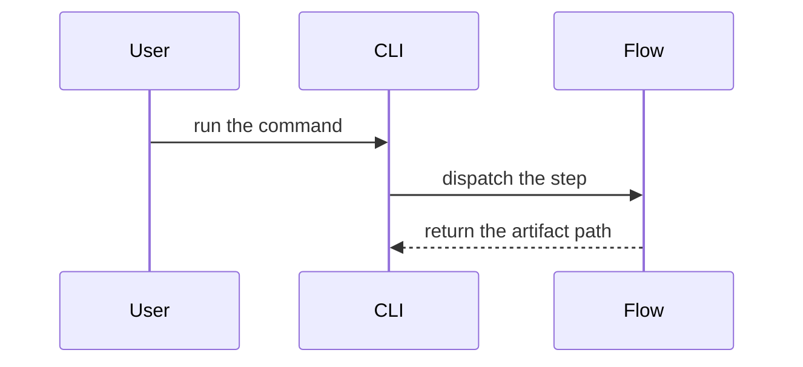

# Show me: text-first views for planning artifacts

Show the reader the shape of the change. Skip preamble, keep prose short, and pick the
smallest view that makes the point clear. Text views are the default. Place each view next
to the short text it supports, and drop any view that does not help a decision.

- Show logic or an algorithm as pseudocode:

```text
on(save)
  if content is unchanged
    return cached result
  write new content
  return fresh result
```

- Show runtime control flow as a call tree:

```text
submitForm
  createSession
    persistPrompt
    launchAgent
  navigateToSession
```

- Show UI structure as a component tree, including the state and module boundaries that matter:

```tsx
<SessionPage> (src/routes/session.tsx)
  useSessionEvents()
  <SessionToolbar>
    <RunSkillButton> (src/ui)
```

- Show file responsibility or a broad refactor as a shallow file tree:

```text
src/
├── commands/       # parses user actions
├── sessions/       # owns session state
└── transport/      # sends API requests
```

- Use proper tree glyphs (`├──`, `└──`, and `│`), not ASCII substitutes. Keep a tree small
  enough to scan: group related files under their shared directory and omit unchanged paths
  unless they give needed context.

- Use `diff` when the point is what changes and the surrounding shape already exists. In a
  `diff` block, start added and changed (`~`) lines with `+`, removed lines with `-`, and
  unchanged context lines with a space. Match the diff shape to the topic.

For a component change:

```diff
 <SessionPage>
   useSessionEvents()
   <SessionToolbar>
+    <RunSkillButton />
   <SessionTimeline>
+    <SkillResultCard />
```

For a file-layout change:

```diff
 src/
 ├── commands/
+│   └── show-me.ts       + owns the new behavior
 ├── sessions/
-└── transport.ts
+└── transport/
+    ├── client.ts
+    └── stream.ts
```

For a call-tree or call-stack change:

```diff
 submitForm
   createSession
     persistPrompt
+    expandSkillMention
     launchAgent
-  navigateToSession
+  navigateToSession
+    subscribeToEvents
```

For a state or control-flow change:

```diff
 on(save)
-  write content
+  if content is unchanged
+    return cached result
+  write new content
+  invalidate cache
```

- Prefer a signature over a body. Show the whole block only when most of it is new, when
  omitted context would hide ownership or order, or when the reader needs a copyable target
  shape:

```ts
function expandSkill(command: string): string {
  const skillName = command.slice(1)
  return `use the ${skillName} skill`
}
```

- A Mermaid diagram is subordinate to the text views above and to the diagram gate: use one
  only when relationships among three or more components are materially clearer than concise
  prose or a text view; otherwise use prose, a small list, or a tree.



- Keep only the calls, files, props, states, and boundaries needed to answer the question in
  front of you. These views describe code shape. Rendered-UI comparison is a separate
  concern owned by the visual-evidence packet, not by these blocks.
